<p align="center">
  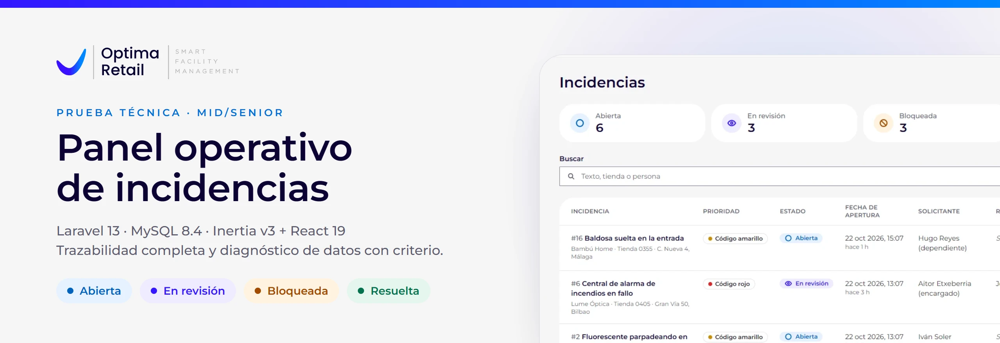
</p>

<p align="center">
  <a href="#probarlo-en-local"><b>Probarlo en local</b></a> ·
  <a href="#recorrido-de-un-minuto">Recorrido</a> ·
  <a href="#cómo-está-hecho">Cómo está hecho</a> ·
  <a href="#diagnóstico-de-inconsistencias-ejercicio-5">Diagnóstico</a> ·
  <a href="#seguridad">Seguridad</a> ·
  <a href="ai-process/README.md">Uso de IA</a>
</p>

<p align="center">
  <a href="https://github.com/danielbrosed/panel-operativo-incidencias/actions/workflows/ci.yml"></a>
  
  
  
  
  
  
  
  
  
</p>

# Panel operativo de incidencias

Prueba técnica mid/senior para **Optima Retail**. Es un panel para consultar y operar las incidencias de mantenimiento
de una red de tiendas: abrirlas, filtrarlas, cambiar su estado con trazabilidad completa y comentarlas. Lo acompaña un
comando que diagnostica los datos inconsistentes y los corrige con prudencia.

El dominio es el suyo. Las prioridades son los **códigos verde, amarillo y rojo** de su formulario «Abrir incidencia»,
y el código rojo lleva su compromiso público de respuesta, «en menos de 4 horas». La identidad visual sigue la de
[optimaretail.eu](https://optimaretail.eu):
- el degradado `#3417FF → #0086FF` y el azul noche `#0C0233`;
- botones píldora y campos redondeados solo por la derecha;
- **Montserrat** empaquetada en el proyecto, como sustituta libre de Gotham, que es de pago.

El logotipo es una marca de Optima Retail y se usa solo para esta prueba. Las tiendas, marcas y personas de los datos
de ejemplo son ficticias.

<picture>
  <source media="(prefers-color-scheme: dark)" srcset="docs/brand/enunciado-dark.svg">
  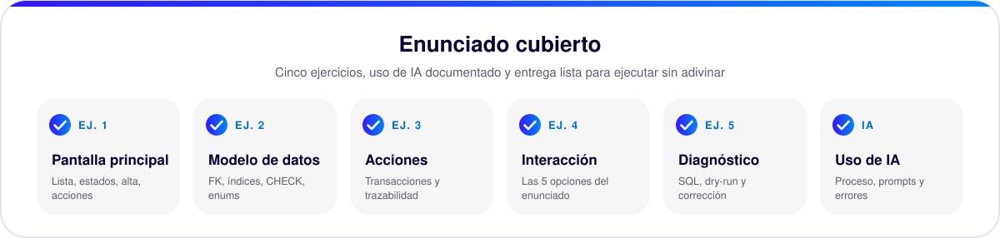
</picture>

## Para quien evalúa

| Requisito del enunciado | Dónde está |
|---|---|
| **Ej. 1** · Pantalla principal | `/incidents`: [`pages/incidents/index.tsx`](resources/js/pages/incidents/index.tsx), con la cabecera en [`layouts/app-layout.tsx`](resources/js/layouts/app-layout.tsx), el alta en [`create-incident-form.tsx`](resources/js/components/create-incident-form.tsx) y el cambio de estado en cada fila ([`status-actions.tsx`](resources/js/components/status-actions.tsx)). Historial en `/incidents/{id}` ([`show.tsx`](resources/js/pages/incidents/show.tsx)) |
| **Ej. 2** · Modelo de datos | [`database/migrations/`](database/migrations) (claves foráneas, índices y CHECK), [`app/Enums/`](app/Enums) (estados centralizados) y [`app/Models/`](app/Models) |
| **Ej. 3** · Acciones y validación | [`app/Actions/Incidents/`](app/Actions/Incidents), [`IncidentListQuery`](app/Queries/IncidentListQuery.php), [`app/Http/Requests/`](app/Http/Requests), [`bootstrap/app.php`](bootstrap/app.php) (errores de dominio en su campo) y [`lang/es/`](lang/es) |
| **Ej. 4** · Interacción | Las cinco opciones: filtro sin recarga ([`use-incident-filters.ts`](resources/js/hooks/use-incident-filters.ts)), confirmación ([`confirm-dialog.tsx`](resources/js/components/confirm-dialog.tsx)), contadores ([`status-counters.tsx`](resources/js/components/status-counters.tsx)), resaltado de vencidas y bloqueadas ([`incident-cells.tsx`](resources/js/components/incident-cells.tsx)) y componentes React |
| **Ej. 5** · Diagnóstico | `php artisan incidents:diagnose` ([comando](app/Console/Commands/DiagnoseIncidents.php) y [`app/Diagnostics/`](app/Diagnostics)), datos rotos a propósito en [`InconsistenciesSeeder`](database/seeders/InconsistenciesSeeder.php), explicación [más abajo](#diagnóstico-de-inconsistencias-ejercicio-5) |
| **Uso de IA** | [`ai-process/`](ai-process/README.md), [`CLAUDE.md`](CLAUDE.md) y [`.claude/skills/`](.claude/skills) |
| **Entrega** | `.env.example` sin credenciales, seeders, este README, [tests](tests) y [CI](.github/workflows/ci.yml) |

## Capturas

Datos de ejemplo recién sembrados, con la interfaz real en Chrome.

<table>
  <tr>
    <td width="50%">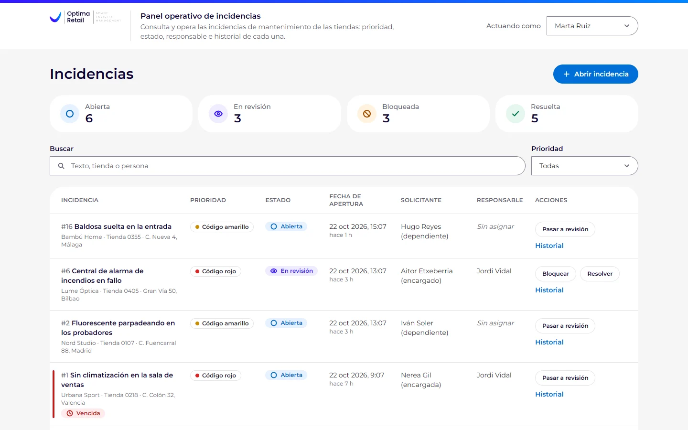<br><sub><b>Listado.</b> Los contadores son el filtro rápido por estado; cada fila trae solo las transiciones que permite el servidor.</sub></td>
    <td width="50%">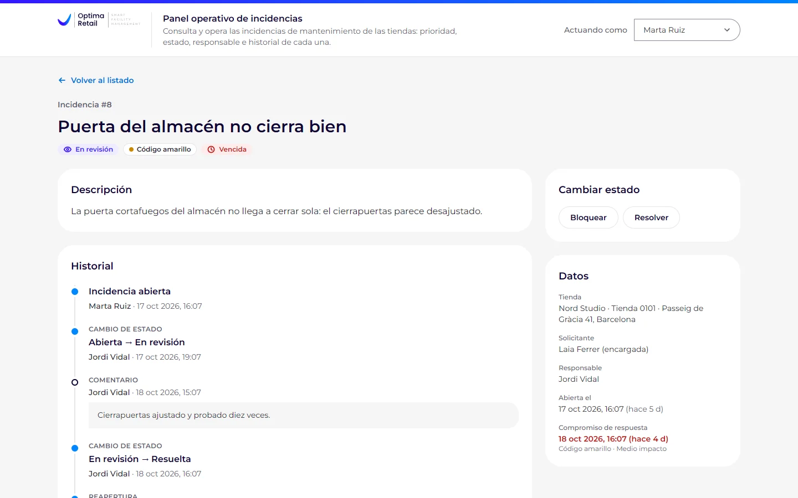<br><sub><b>Ficha.</b> Cambios de estado y comentarios en una sola línea de tiempo, con una reapertura y su motivo.</sub></td>
  </tr>
  <tr>
    <td width="50%">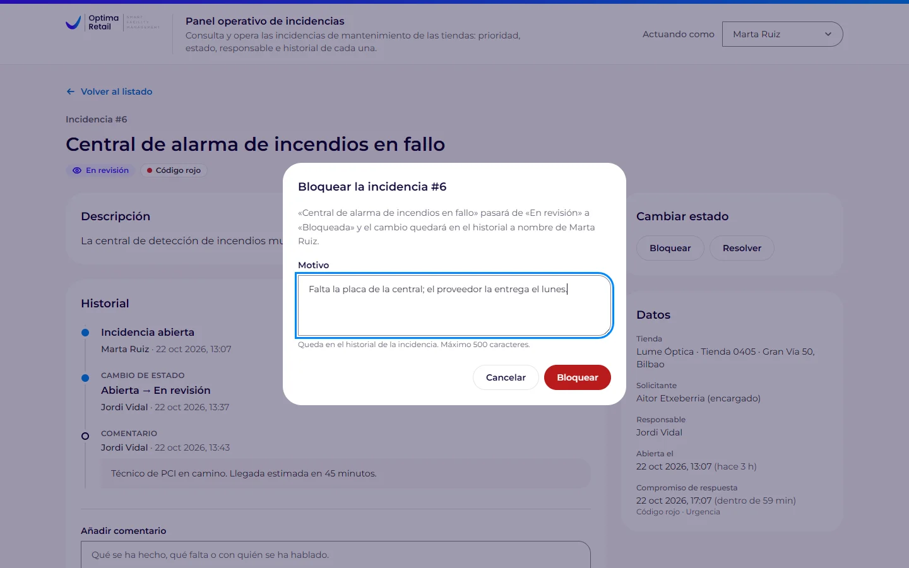<br><sub><b>Confirmación.</b> Bloquear, resolver y reabrir piden confirmación; bloquear y reabrir, además, un motivo.</sub></td>
    <td width="50%">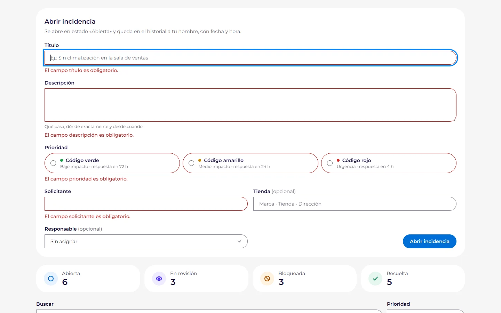<br><sub><b>Validación.</b> Cada error sale junto a su campo y en español.</sub></td>
  </tr>
  <tr>
    <td width="50%">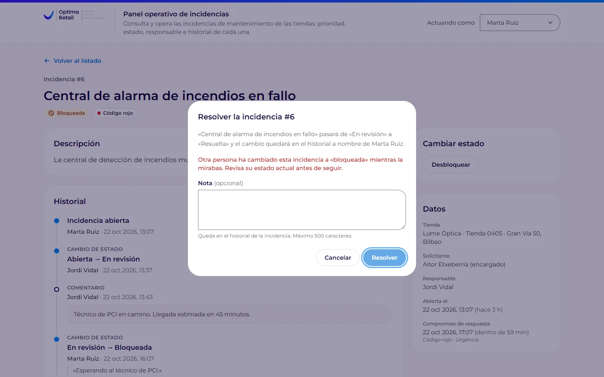<br><sub><b>Conflicto.</b> Si otra persona cambió la incidencia, el diálogo lo dice en vez de pisar su cambio.</sub></td>
    <td width="50%">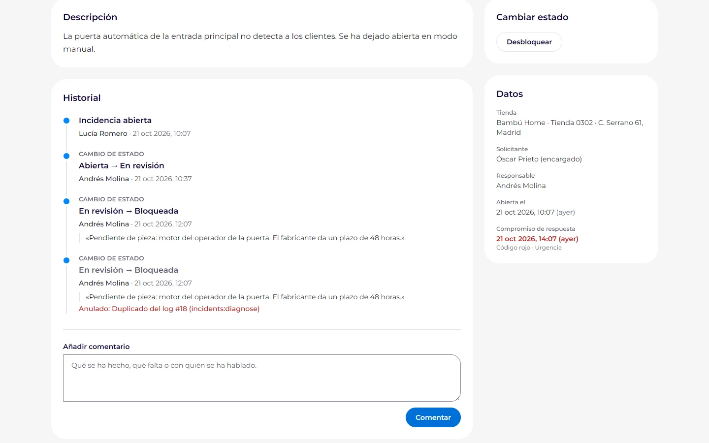<br><sub><b>Después del diagnóstico.</b> El log duplicado sigue a la vista, tachado y con el motivo de la anulación.</sub></td>
  </tr>
  <tr>
    <td width="50%">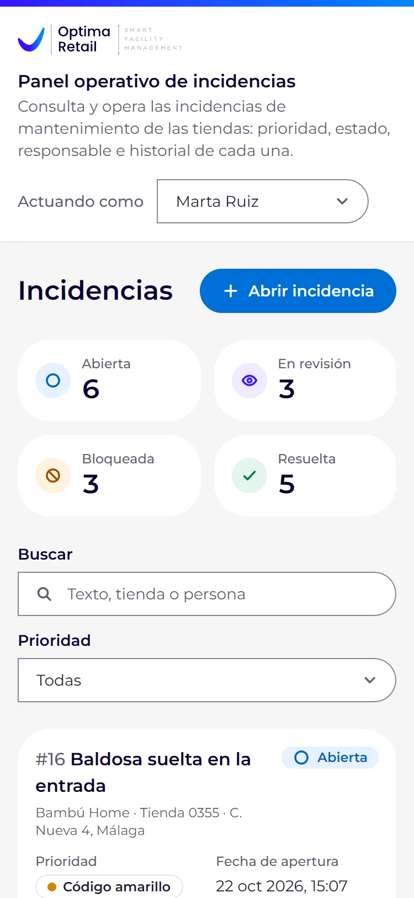<br><sub><b>Móvil.</b> Por debajo de 1280 px la tabla pasa a tarjetas, sin desbordar a 375 px.</sub></td>
    <td width="50%">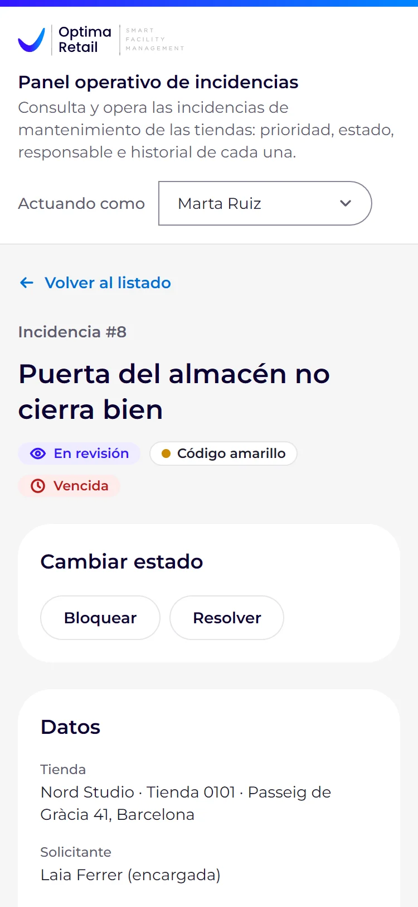<br><sub><b>Ficha en el móvil.</b> Datos y acciones primero, historial después.</sub></td>
  </tr>
</table>

## Probarlo en local

| | Versión | Notas |
|---|---|---|
| PHP | 8.3 o superior | La CI prueba 8.3 y 8.4. Extensiones: `pdo_mysql`, `mbstring`, `intl`, `openssl`, `fileinfo`, `curl` y `xml` |
| Composer | 2 | El `composer.lock` está resuelto para PHP 8.3 (`config.platform.php`) |
| Node.js y npm | 22.12 o superior | Desarrollado con Node 24 (`.nvmrc`) |
| MySQL | 8.0.17 o superior | Usa CHECK, funciones ventana y la intercalación exacta `utf8mb4_0900_bin`. Probado con 8.4 LTS. MariaDB no está probado |

No hace falta Docker.

```bash
git clone https://github.com/danielbrosed/panel-operativo-incidencias.git
cd panel-operativo-incidencias

composer install
cp .env.example .env          # en cmd.exe: copy .env.example .env
php artisan key:generate

# La base de la aplicación y la de los tests (añade -p si tu usuario tiene contraseña)
mysql -u root -e "CREATE DATABASE IF NOT EXISTS incidents CHARACTER SET utf8mb4 COLLATE utf8mb4_unicode_ci; CREATE DATABASE IF NOT EXISTS incidents_testing CHARACTER SET utf8mb4 COLLATE utf8mb4_unicode_ci;"

npm ci
npm run build

php artisan migrate:fresh --seed   # borra y recrea las tablas de la base de .env y carga los datos de ejemplo
php artisan serve                  # http://127.0.0.1:8000
```

- **Base de datos.** `.env.example` apunta a `root` sin contraseña en `127.0.0.1:3306`. Si tu MySQL es otro, cambia
  `DB_*` en `.env`; los tests usan esos mismos datos contra `incidents_testing`.
- **Atajos.** `composer setup` hace la instalación, `.env`, clave y compilación. `composer run dev` levanta PHP (8000) y
  Vite (5173) con recarga en caliente.
- **Sin autenticación.** No hay usuario de prueba: el selector «Actuando como» de la cabecera decide quién firma cada
  acción, entre cuatro operadores ficticios de [`config/incidents.php`](config/incidents.php).

**Datos de ejemplo.** `migrate:fresh --seed` crea 16 incidencias coherentes con
[`DemoIncidentsSeeder`](database/seeders/DemoIncidentsSeeder.php). Se generan con las mismas acciones que usa el panel,
avanzando el reloj paso a paso, y sus fechas son relativas al momento de sembrar, así que «vencida» tiene sentido el día
que se ejecute. Después, [`InconsistenciesSeeder`](database/seeders/InconsistenciesSeeder.php) estropea tres de ellas
(#5, #9 y #11) y añade una importada (#17) para el ejercicio 5. Quedan 17 incidencias en los cuatro estados, siempre
con los mismos ids.

<details>
<summary>Si algo falla</summary>

- **Página en blanco o sin estilos** tras cortar `npm run dev` de golpe: borra `public/hot`. Vite lo deja al morir y la
  aplicación sigue pidiéndole los JS y CSS compilados a un servidor que ya no existe.
- **Error de conexión a la base de datos**: revisa `DB_*` en `.env` y que la base `incidents` exista.
- **Los tests se niegan a arrancar** si el nombre de la base no contiene `_testing`. Es a propósito: borran el esquema.
</details>

## Recorrido de un minuto

1. Pulsa los **contadores por estado**: la lista se filtra sin recargar y la URL guarda el filtro. Cada contador respeta
   la prioridad y el texto buscados, así que su número es lo que verás al pulsarlo.
2. **Busca** «Valencia» (título, descripción, tienda y personas) y **filtra por prioridad**.
3. **Abre una incidencia** con el formulario vacío: cada error sale junto a su campo. Después créala bien: aparece la
   primera, abierta y con su vencimiento según la prioridad.
4. **Cambia el estado desde la lista**: cada fila ofrece solo las transiciones que permite el servidor. Resolver, bloquear
   y reabrir piden confirmación; bloquear y reabrir, además, un motivo.
5. Abre el **historial** de «Puerta del almacén no cierra bien»: cambios y comentarios en una sola línea de tiempo, con una
   reapertura y su motivo. Añade un comentario.
6. **Resaltado**: «Sin climatización en la sala de ventas» (código rojo, abierta hace 7 horas) sale vencida; «Goteras en
   el falso techo tras la lluvia», bloqueada.
7. Cambia **«Actuando como»** y haz otra acción: el historial la firma con el nuevo nombre. Abre una incidencia en
   revisión (por ejemplo, «#6 Central de alarma de incendios en fallo») en dos pestañas, bloquéala en una e intenta
   resolverla en la otra: el diálogo avisa de que otra persona la cambió y recalcula los botones.

## Cómo está hecho

### Arquitectura

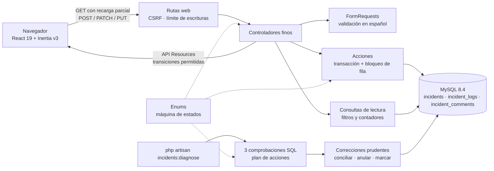

- **Los enums son la única fuente de verdad** ([`app/Enums/`](app/Enums)). `IncidentStatus` define estados, etiquetas,
  transiciones, cuándo piden motivo y confirmación y qué acción de log toca. Las acciones lo aplican, los API Resources
  mandan a cada incidencia sus transiciones permitidas y el diagnóstico lo usa para juzgar los huecos.
- **Toda escritura pasa por una acción** ([`app/Actions/Incidents/`](app/Actions/Incidents)). `ChangeIncidentStatus`
  bloquea la fila (`SELECT … FOR UPDATE`) y trabaja con la copia recién leída. Comprueba que el estado sigue siendo el
  que vio la persona, la transición y el motivo, y guarda estado y log en la misma transacción. `CreateIncident` escribe
  la incidencia y su log `created` juntos. `AddIncidentComment` es una única inserción que no toca la incidencia, así
  que no necesita transacción.
- **Los errores salen en su campo.** Los errores de dominio se convierten en errores de validación sobre `status` o
  `reason` y vuelven al mismo formulario. Un cliente JSON recibe 422, o 409 si el estado estaba desactualizado; a
  Inertia nunca se le manda un 409, que reserva para sus redirecciones. Una sesión caducada (419) o el exceso de
  peticiones (429) vuelven atrás con un aviso.

### Máquina de estados

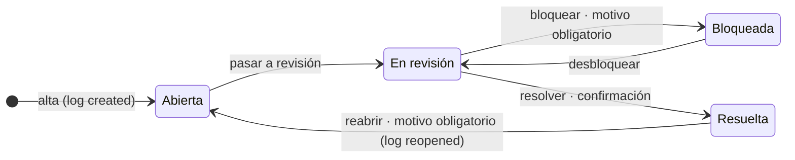

| desde \ a | abierta | en revisión | bloqueada | resuelta |
|---|---|---|---|---|
| abierta | – | sí | no | no |
| en revisión | no | – | sí: **motivo obligatorio** y confirmación | sí: confirmación, nota opcional |
| bloqueada | no | sí (desbloquear) | – | no |
| resuelta | sí: **reapertura**, acción `reopened`, motivo obligatorio y confirmación | no | no | – |

Bloquear pide motivo porque es lo que necesita quien desbloquee; reabrir, para que la reapertura sea explícita, como
pide el enunciado. Una bloqueada vuelve a revisión antes de resolverse, para que toda resolución siga a trabajo activo.

### Modelo de datos

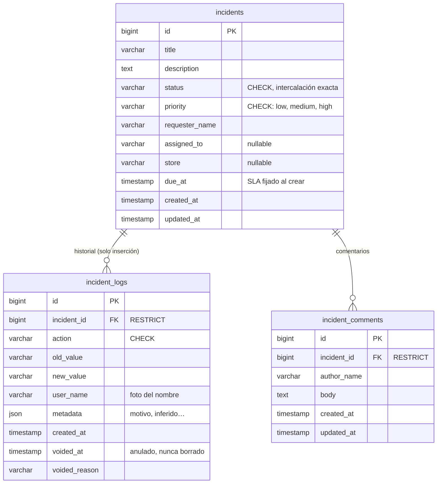

- **Índices.** `incidents (status, created_at)`, `(priority, created_at)` y `(created_at)`, porque la lista filtra por
  estado o prioridad y siempre ordena por fecha. `incident_logs (incident_id, created_at, id)`, para el historial en
  orden y las funciones ventana del diagnóstico. `incident_comments (incident_id, created_at)`.
- **Historial solo de inserción** ([`IncidentLog`](app/Models/IncidentLog.php)). Un log se anula una vez, con motivo,
  pero nunca se edita ni se borra, y la clave foránea `RESTRICT` impide borrar una incidencia con historial. No hay
  columnas `resolved_at` ni «marcada»: serían otra fuente de verdad que conciliar. La insignia «Revisión manual» se
  calcula desde los logs.
- **CHECK con intercalación exacta** en `status`, `priority` e `incident_logs.action`. Son una defensa ante escrituras
  que se saltan la aplicación, justo las del ejercicio 5. Con la intercalación por defecto, `'OPEN'` o `'open '` pasarían
  el CHECK. Las migraciones escriben los valores a propósito: son una foto del esquema.
- **`due_at` se fija al crear.** Es el compromiso de ese momento y no se mueve si cambia la política de SLA. El código
  rojo da 4 h, la promesa pública de Optima Retail; el amarillo, 24 h, y el verde, 72 h, son supuestos de esta prueba.
- **Los comentarios no generan log**: el comentario ya es su propia traza y saldría dos veces en el historial.

### Frontend: estado, acciones y refresco

- **Dónde vive el estado.** Los filtros viven en la URL (`?status=…&priority=…&q=…`) y los datos los manda siempre el
  servidor como props de Inertia, tipadas en [`types/incident.ts`](resources/js/types/incident.ts) (espejo de los API
  Resources): el cliente no guarda ninguna copia de las incidencias ni de la máquina de estados. Lo único local:
  - el texto de la búsqueda mientras se escribe y los filtros de la visita en curso (`use-incident-filters.ts`);
  - los formularios (`useForm` en `create-incident-form.tsx`, `status-actions.tsx` y `comment-form.tsx`);
  - qué diálogo de confirmación está abierto y si el formulario de alta está desplegado;
  - el operador que se está guardando (`actor-switcher.tsx`) y el aviso visible (`flash-toaster.tsx`).
- **Dónde se dispara la acción.** Las visitas de filtrado salen solo de `use-incident-filters.ts`: contadores, prioridad,
  búsqueda (300 ms de espera, Intro inmediato) y «Quitar filtros». Son recargas parciales
  (`only: ['incidents', 'counts', 'filters']`, `preserveState`, `replace`), y el servidor calcula solo esas tres props,
  como comprueba un test. Crear, cambiar de estado, comentar y «Actuando como» salen de su propio componente. Crear,
  cambiar de estado y comentar llevan su propio `errorBag`, para que los errores vuelvan al formulario que los provocó.
- **Cómo se refresca.** El servidor contesta con una redirección, Inertia vuelve a pedir la página y con las props nuevas
  se repintan la fila, las insignias, los contadores y el historial. El aviso (`flash.toast`) llega por el evento `flash`
  del router, y tras un cambio de estado el foco pasa al primer botón nuevo de esa incidencia.
- **Diseño.** Los tokens de marca viven en un único `@theme` de Tailwind ([`app.css`](resources/css/app.css)), con
  todos los pares de texto comprobados para contraste AA. Los componentes son pequeños y van en kebab-case. La lista es
  una tabla desde 1280 px y tarjetas por debajo: seis columnas de datos más la de acciones no caben en menos.

## Diagnóstico de inconsistencias (ejercicio 5)

```bash
php artisan incidents:diagnose                 # dry-run: enseña lo que haría y no escribe nada
php artisan incidents:diagnose -v              # además, el porqué y el SQL exacto de cada comprobación
php artisan incidents:diagnose --fix           # aplica exactamente esa lista, tras pedir confirmación
php artisan incidents:diagnose --fix --force   # sin preguntar (CI)
php artisan incidents:review 11 --actor="Marta Ruiz" --reason="…"   # una persona cierra un caso marcado
```

- **Código de salida.** Sale con 1 si queda algo que `--fix` haría, si `--fix` no se confirma o si omite alguna
  corrección; si no, con 0. Después de aplicar, `--fix` vuelve a planificar y sale con 1 si aún queda algo pendiente.
  Los casos ya marcados o revisados se listan, pero no cuentan.
- **Lo que ves es lo que se aplica.** El dry-run y `--fix` comparten la misma lista de acciones. Cada corrección va en
  su transacción, con la incidencia bloqueada y el hallazgo comprobado otra vez dentro del bloqueo, porque entre el
  dry-run y el `--fix` pudo cambiar algo.
- **Es idempotente.** La segunda pasada no escribe nada. Con `-n` (sin interacción) y sin `--force`, `--fix` no aplica
  nada y sale con 1.

> **Regla única de corrección.** Solo se corrige automáticamente cuando (1) no cambia el estado de la incidencia, (2) no
> hay que inventar fecha, autor ni motivo, y (3) el hueco se explica con una única transición permitida por la máquina
> de estados que no exige motivo. Todo lo demás se marca para revisión manual.

El diagnóstico nunca cambia `incidents.status`: si la fila y su historial no coinciden, no sabe cuál dice la verdad.
Tampoco borra ni atrasa un log:
- un log reconstruido (`status_reconciled`) lleva la fecha real de la corrección, el actor `sistema:diagnostico` y
  `metadata.inferred = true`;
- uno sobrante se anula con motivo y sigue a la vista, tachado;
- marcar es añadir un log `flagged_for_review`, que en el panel se ve como la insignia «Revisión manual».

Aunque se cumpla la regla, el diagnóstico marca en vez de corregir si el historial no es de fiar: la evidencia tiene
fecha futura, el historial no empieza por `created` o la misma incidencia tiene un log duplicado o incoherente. Y si un
valor guardado no es un estado conocido, también lo marca en vez de fallar.

### Los cuatro casos simulados

| Caso | Incidencia | Causa simulada | Qué queda en la base | Del enunciado | Resultado |
|---|---|---|---|---|---|
| A | #5 Fuga de agua en aseo de clientes | Soporte la dio por resuelta con un `UPDATE` a mano tras la llamada del técnico | `resolved`, con el último log de estado en `in_review` | Resuelta sin log de resolución | **Se concilia**: falta un único paso permitido y sin motivo (en revisión → resuelta) |
| B | #11 Persiana metálica de acceso no sube | Reabierta directamente en la base de datos | `open`, con el último log de estado en `resolved` | Estado distinto de su último log | **Se marca**: el paso que falta es una reapertura, que exige un motivo que no se puede inventar |
| C | #9 Puerta automática no abre | Doble clic en «Bloquear» en una versión sin bloqueo de fila | Dos logs `in_review → blocked` iguales, del mismo autor, con 1 s de diferencia | Log duplicado | **Se anula la copia** (#40), con un motivo que apunta al original (#18); no se borra |
| D | #17 Cuadro eléctrico salta de forma intermitente | Importación del sistema anterior (`importacion-legacy`) que perdió un paso | Solo `created` (null → open) y después `in_review → blocked`: falta abierta → en revisión | Log incoherente | **Se marca**: rellenar el hueco obligaría a inventar ese paso, con su fecha y su autor |

Cada caso salta solo en su comprobación, como garantiza un test, y la reapertura legítima de «Puerta del almacén no
cierra bien» no sale.

### Consultas y por qué detectan el problema

Los **logs de estado** son `created`, `status_changed`, `reopened` y `status_reconciled`
(`IncidentLogAction::statusTrail()`), sin los anulados. El **último** es el primero por `created_at DESC, id DESC`. Las
consultas interpolan los valores de los enums, así que nunca se separan de la máquina de estados y no reciben ningún
dato de usuario. Este es el SQL literal que ejecuta el comando (`-v` lo imprime).

1. **Resueltas sin log de resolución.** `ROW_NUMBER()` da el último log de estado de cada incidencia. Si la incidencia
   está `resolved` y ese log no termina en `resolved`, nadie registró la resolución.
2. **Estado distinto del último log.** El mismo log, comparado con `incidents.status` en el resto de estados. Si no
   coinciden, la fila cambió por un camino que no dejó rastro.
3. **Logs duplicados o incoherentes.** `LAG()` compara cada log con el anterior de su incidencia. Es un duplicado si
   repite acción, valores y autor en 2 s o menos (`config/incidents.php`). Es incoherente si su `old_value` no es el
   `new_value` del anterior, o si `IncidentStatus` no permite esa transición.

<details>
<summary>SQL de las comprobaciones 1 y 2</summary>

```sql
WITH last_trail AS (
    SELECT l.incident_id, l.id AS log_id, l.new_value,
        ROW_NUMBER() OVER (PARTITION BY l.incident_id ORDER BY l.created_at DESC, l.id DESC) AS rn
    FROM incident_logs l
    WHERE l.voided_at IS NULL
        AND l.action IN ('created', 'status_changed', 'reopened', 'status_reconciled')
)
SELECT i.id AS incident_id, i.title, i.status, t.log_id AS last_log_id, t.new_value AS logged_status
FROM incidents i
LEFT JOIN last_trail t ON t.incident_id = i.id AND t.rn = 1
WHERE i.status = 'resolved'
    AND (t.new_value IS NULL OR t.new_value <> 'resolved')
ORDER BY i.id
```

La comprobación 2 es la misma consulta con otra condición. Las resueltas son de la comprobación 1, así que una
incidencia nunca sale en las dos:

```sql
WHERE i.status <> 'resolved'
    AND (t.new_value IS NULL OR t.new_value <> i.status)
```
</details>

<details>
<summary>SQL de la comprobación 3</summary>

```sql
WITH trail AS (
    SELECT l.id, l.incident_id, l.action, l.old_value, l.new_value, l.user_name, l.created_at,
        LAG(l.id) OVER w AS previous_id,
        LAG(l.action) OVER w AS previous_action,
        LAG(l.old_value) OVER w AS previous_old_value,
        LAG(l.new_value) OVER w AS previous_new_value,
        LAG(l.user_name) OVER w AS previous_user_name,
        TIMESTAMPDIFF(SECOND, LAG(l.created_at) OVER w, l.created_at) AS seconds_since_previous
    FROM incident_logs l
    WHERE l.voided_at IS NULL
        AND l.action IN ('created', 'status_changed', 'reopened', 'status_reconciled')
    WINDOW w AS (PARTITION BY l.incident_id ORDER BY l.created_at, l.id)
),
classified AS (
    SELECT t.*,
        CASE
            WHEN t.previous_id IS NOT NULL
                AND t.action = t.previous_action
                AND t.old_value <=> t.previous_old_value
                AND t.new_value <=> t.previous_new_value
                AND t.user_name = t.previous_user_name
                AND t.seconds_since_previous <= 2
                THEN 'duplicate'
            WHEN t.action <> 'created'
                AND (NOT (t.old_value <=> t.previous_new_value)
                    OR ((t.old_value, t.new_value) IN (('open', 'in_review'), ('in_review', 'blocked'), ('in_review', 'resolved'), ('blocked', 'in_review'), ('resolved', 'open'))) IS NOT TRUE)
                THEN 'broken_chain'
        END AS kind
    FROM trail t
)
SELECT c.incident_id, i.title, c.kind, c.id AS log_id, c.action, c.old_value, c.new_value, c.user_name,
    c.previous_id AS previous_log_id, c.previous_new_value, c.seconds_since_previous
FROM classified c
JOIN incidents i ON i.id = c.incident_id
WHERE c.kind IS NOT NULL
ORDER BY c.incident_id, c.created_at, c.id
```

Un duplicado también rompe la cadena, pero se clasifica como duplicado porque se sabe qué pasó.
</details>

### Salida real

El dry-run lista A, B, C y D y sale con 1. `--fix --force` concilia A, anula la copia de C, marca B y D y sale con 0.
La pasada siguiente sale con 0 y muestra B y D ya en revisión manual; la CI comprueba esos códigos (1 → 0 → 0) en
cada push a `main`. Después, una persona cierra B y D con `incidents:review`, y un último `--fix` no escribe nada.
Salida real tras `migrate:fresh --seed`:

```text
$ php artisan incidents:diagnose

1. Incidencias resueltas sin log de resolución (resolved_without_resolution_log)
+----------------------------+--------------------------------------------+--------------------------------------------+
| Incidencia                 | Detalle                                    | Acción prevista                            |
+----------------------------+--------------------------------------------+--------------------------------------------+
| #5 Fuga de agua en aseo de | Está «resuelta», pero su último log de     | Automática. Se añade un log                |
| clientes                   | estado (#6) la deja «en revisión».         | status_reconciled «en revisión» →          |
|                            |                                            | «resuelta» con la fecha de la corrección   |
|                            |                                            | (inferred): es el único paso posible y no  |
|                            |                                            | exige motivo.                              |
+----------------------------+--------------------------------------------+--------------------------------------------+

2. Incidencias cuyo estado no coincide con su último log (status_differs_from_last_log)
+----------------------------+--------------------------------------------+--------------------------------------------+
| Incidencia                 | Detalle                                    | Acción prevista                            |
+----------------------------+--------------------------------------------+--------------------------------------------+
| #11 Persiana metálica de   | Está «abierta», pero su último log de      | Revisión manual. Pasar de «resuelta» a     |
| acceso no sube             | estado (#24) la deja «resuelta».           | «abierta» exige un motivo que no consta en |
|                            |                                            | ningún sitio.                              |
+----------------------------+--------------------------------------------+--------------------------------------------+

3. Logs de estado duplicados o incoherentes (duplicate_or_incoherent_log)
+----------------------------+--------------------------------------------+--------------------------------------------+
| Incidencia                 | Detalle                                    | Acción prevista                            |
+----------------------------+--------------------------------------------+--------------------------------------------+
| #9 Puerta automática no    | El log #40 repite el #18 («en revisión» →  | Automática. Se anula el log #40 como       |
| abre                       | «bloqueada», Andrés Molina) 1 s después.   | duplicado del #18; no se borra.            |
| #17 Cuadro eléctrico salta | El log #42 («en revisión» → «bloqueada»)   | Revisión manual. Falta al menos un paso de |
| de forma intermitente      | no sigue al anterior, el #41, que la dejó  | la historia y no se sabe cuándo ni quién   |
|                            | «abierta».                                 | lo dio.                                    |
+----------------------------+--------------------------------------------+--------------------------------------------+

Resumen: 2 automáticas, 2 a revisión manual, 0 ya en revisión manual.
Regla: Solo se corrige automáticamente cuando (1) la corrección no cambia el estado de la incidencia, (2) no
hay que inventar fecha, autor ni motivo y (3) el hueco se explica con una única transición permitida que no
exige motivo. Todo lo demás se marca para revisión manual. Ningún log se borra ni se atrasa.

Simulación: no se ha modificado nada. Ejecuta con --fix para aplicar las correcciones.
```

<details>
<summary>«--fix», la pasada siguiente y el cierre de B y D por una persona</summary>

```text
$ php artisan incidents:diagnose --fix --force
(… el mismo informe …)
#5 Fuga de agua en aseo de clientes (resolved_without_resolution_log): corregida.
#11 Persiana metálica de acceso no sube (status_differs_from_last_log): marcada para revisión manual.
#9 Puerta automática no abre (duplicate_or_incoherent_log): corregida.
#17 Cuadro eléctrico salta de forma intermitente (duplicate_or_incoherent_log): marcada para revisión manual.
Resultado: aplicadas 4, omitidas 0.

$ php artisan incidents:diagnose
(… B y D: «Ya marcada para revisión manual (fecha)» …)
Resumen: 0 automáticas, 0 a revisión manual, 2 ya en revisión manual.
Nada que corregir: lo que queda ya está marcado para revisión manual.

$ php artisan incidents:review 11 --actor="Marta Ruiz" --reason="La tienda confirmó por teléfono la reapertura del 19 de octubre."
#11 Persiana metálica de acceso no sube
Se añade el log #46 (status_reconciled «resuelta» → «abierta»), firmado por Marta Ruiz y con su motivo.
Marcas revisadas: #44 (status_differs_from_last_log).
Revisión registrada.

$ php artisan incidents:review 17 --actor="Andrés Molina" --reason="Importación revisada con el sistema anterior: el paso a revisión se dio el mismo día."
#17 Cuadro eléctrico salta de forma intermitente
Sin log de estado: su último log de estado ya la deja «bloqueada», como está.
Marcas revisadas: #45 (duplicate_or_incoherent_log).
Revisión registrada.

$ php artisan incidents:diagnose

1. Incidencias resueltas sin log de resolución (resolved_without_resolution_log)
Sin hallazgos.

2. Incidencias cuyo estado no coincide con su último log (status_differs_from_last_log)
Sin hallazgos.

3. Logs de estado duplicados o incoherentes (duplicate_or_incoherent_log)
+----------------------------+--------------------------------------------+--------------------------------------------+
| Incidencia                 | Detalle                                    | Acción prevista                            |
+----------------------------+--------------------------------------------+--------------------------------------------+
| #17 Cuadro eléctrico salta | El log #42 («en revisión» → «bloqueada»)   | Revisada por Andrés Molina: Importación    |
| de forma intermitente      | no sigue al anterior, el #41, que la dejó  | revisada con el sistema anterior: el paso  |
|                            | «abierta».                                 | a revisión se dio el mismo día (22/10/2026 |
|                            |                                            | 14:08 UTC).                                |
+----------------------------+--------------------------------------------+--------------------------------------------+

Resumen: 0 automáticas, 0 a revisión manual, 0 ya en revisión manual, 1 revisadas.
Regla: Solo se corrige automáticamente cuando (1) la corrección no cambia el estado de la incidencia, (2) no
hay que inventar fecha, autor ni motivo y (3) el hueco se explica con una única transición permitida que no
exige motivo. Todo lo demás se marca para revisión manual. Ningún log se borra ni se atrasa.

Nada que corregir: lo que queda ya está revisado.
```
</details>

### Qué hace una persona con un caso marcado

1. Lo localiza en la salida del comando o por la insignia «Revisión manual»: el historial de la incidencia muestra la
   marca con la explicación.
2. Averigua qué pasó fuera de la base de datos: el parte del técnico, la tienda, quién lanzó el SQL o la importación.
   Sin eso, cualquier corrección sería inventada.
3. Cierra el caso con su nombre y su conclusión:

   ```bash
   php artisan incidents:review 11 --actor="Marta Ruiz" --reason="La tienda confirmó por teléfono la reapertura del 19 de octubre."
   ```

   Si el hueco es un único paso permitido al final del historial (como en B), el comando lo registra como
   `status_reconciled` **firmado por esa persona y con su motivo**: lo que la máquina no puede inventar, una persona sí
   puede afirmarlo. Si el hueco está en medio del historial (como en D), no escribe ningún paso: deja constancia de la
   revisión. En los dos casos anula la marca con el motivo «Revisada por…», y el diagnóstico deja de contarla.

### Cómo se evita que vuelva a pasar

- El estado solo cambia con `ChangeIncidentStatus` (`status` no está en `$fillable`), y estado y log se guardan en la
  misma transacción: desde el panel no pueden salir A ni B.
- `lockForUpdate()` y estado esperado: la segunda petición de un doble clic espera al bloqueo, ve la incidencia ya
  bloqueada y responde «La incidencia ya está “bloqueada”» en vez de escribir otro log (C). Si fue otra persona quien la
  cambió, el aviso es de conflicto.
- CHECK con intercalación exacta y log solo de inserción. El modelo impide editarlo o borrarlo y solo deja anularlo una
  vez, con motivo, en una sola sentencia condicional, de modo que dos procesos no pueden anularlo a la vez. Además, la
  base exige que `voided_at` y `voided_reason` vayan siempre juntos.
- La aplicación no puede impedir un `UPDATE` a mano ni una importación que se salte las acciones (A, B y D): para eso
  están los permisos de producción y este diagnóstico.

<details>
<summary>Límites y uso en producción</summary>

**Límites**

- No sabe si la verdad está en la fila o en el historial: por eso nunca cambia estados.
- Si alguien cambia la fila a mano **y** escribe un log que cuadra, no hay nada que detectar.
- El duplicado depende de la ventana de 2 s y del mismo autor. Dos clics más separados no cuentan como duplicado,
  pero la máquina de estados no permite repetir una transición seguida, así que saldrían como incoherentes y se
  marcarían.
- La comprobación 3 valida el par (anterior, nuevo) y la continuidad de la cadena; no comprueba que una transición que
  exige motivo lo traiga en `metadata`.
- Solo mira los logs de estado (no comentarios ni `due_at`) y recorre todo `incident_logs` en cada pasada; con mucho
  volumen se haría por tramos de `incident_id`.
- Las protecciones del modelo no cubren las escrituras que no pasan por él: `DB::table()`, borrados en masa desde una
  relación o `saveQuietly()`. En producción las cierra el usuario de base de datos con permisos mínimos.
- Un triple envío muy rápido se resuelve en dos pasadas: la primera anula una copia y, al volver a planificar, `--fix`
  sale con 1 y deja la otra para la siguiente.

**En producción**

- **Copia antes de `--fix`**, guardada con la salida del dry-run:

  ```bash
  mysqldump --single-transaction --no-tablespaces incidents > incidents-antes-del-fix.sql
  ```

- **El usuario de la aplicación, sin `DELETE` ni `UPDATE` general sobre `incident_logs`**, para que el «solo
  inserción» no dependa solo del modelo (las migraciones, con otro usuario):

  ```sql
  GRANT SELECT, INSERT, UPDATE ON incidents.incidents TO 'panel'@'localhost';
  GRANT SELECT, INSERT ON incidents.incident_comments TO 'panel'@'localhost';
  GRANT SELECT, INSERT, UPDATE (voided_at, voided_reason) ON incidents.incident_logs TO 'panel'@'localhost';
  ```
</details>

## Seguridad

Antes de publicar el repositorio pasé una auditoría de seguridad, documentada en
[`docs/auditoria-seguridad.md`](docs/auditoria-seguridad.md), con su alcance, su método, los hallazgos y cómo se cerró
cada uno. En resumen:

- **Entradas.** CSRF en todas las escrituras y `$fillable` explícito: el estado y las fechas no se pueden asignar desde
  fuera. Las entradas manipuladas (arrays, UTF-8 inválido, caracteres de control o de dirección bidi) se rechazan como
  error de validación, nunca como un 500. Hay un límite de 60 escrituras por minuto e IP.
- **Salida.** React escapa todo, no hay `dangerouslySetInnerHTML`, y los datos iniciales de la página viajan con
  `JSON_HEX_TAG`.
- **Cabeceras.** Cabeceras de seguridad y CSP con nonce por petición
  ([`SecurityHeaders`](app/Http/Middleware/SecurityHeaders.php)). En local va en modo informe, para que nadie vea una
  página en blanco por una violación; en el resto de entornos se aplica, y un valor desconocido la aplica en vez de
  apagarla.
- **Cadena de suministro.** `.npmrc` con `ignore-scripts=true`, auditoría de dependencias en la CI y acciones fijadas
  por commit.
- **Producción.** `APP_ENV=production`, `APP_DEBUG=false`, `APP_URL` real, `SESSION_SECURE_COOKIE=true` y CSP aplicada. Si hay un proxy delante, `trustProxies`. Y
  nunca exponer el panel sin autenticación: el «Actuando como» solo sirve para esta prueba.

## Tests y calidad

```bash
php artisan test     # contra la base incidents_testing
composer check       # Pint, Larastan (nivel 8), tsc, ESLint, Prettier y los tests
```

105 tests y 599 aserciones, contra MySQL y no SQLite: el bloqueo de fila, las CHECK, el JSON y las
funciones ventana son parte de lo probado, y SQLite no los reproduce. No necesitan `npm run build`. Cubren:
- la matriz completa de transiciones;
- filtros, escapado de `LIKE`, contadores y recarga parcial;
- validación, incluidas las entradas manipuladas;
- estado desactualizado y doble envío, y que se deshace todo si falla el log;
- el `FOR UPDATE`, la inmutabilidad del log, las CHECK y las claves foráneas;
- seguridad: escapado, CSP, límite de escrituras y errores de producción;
- el diagnóstico: sin falsos positivos con datos limpios, dry-run que no toca nada, cada caso sembrado, idempotencia,
  códigos de salida y el cierre de casos marcados.

| Trabajo de la CI | Qué hace |
|---|---|
| Backend · PHP 8.3 y 8.4 con MySQL 8.4 | `composer validate`, instalación, compilación, Pint, Larastan, tests (más tsc, ESLint y Prettier en el de 8.4) y una prueba de humo que sigue este README: `migrate:fresh --seed` y el diagnóstico, con las salidas 1 → 0 → 0 |
| Frontend · Linux, Windows y macOS | `npm ci`, tsc y compilación: detecta importaciones que solo funcionan porque Windows no distingue mayúsculas |
| Auditoría de dependencias | `composer audit` y `npm audit --audit-level=high` |

## Uso de IA

La prueba se hizo con IA y está documentado sin esconder nada en [`ai-process/`](ai-process/README.md). Ahí está qué
herramientas se usaron, cómo se dirigió el trabajo, los encargos literales que la IA dio a sus agentes, qué decidí yo y
qué errores de la IA se detectaron y cómo se corrigieron. Las reglas con las que se dirigió están en el propio
repositorio: [`CLAUDE.md`](CLAUDE.md) y las tres skills de [`.claude/skills/`](.claude/skills) (`incident-domain`,
`data-fix-protocol` y `review-checklist`).

## Fuera de alcance y siguientes pasos

- **Fuera de alcance, a propósito:**
  - autenticación, roles y permisos (`CurrentActor` es el único punto que cambiaría);
  - notificaciones, Docker, despliegue público e integraciones externas, como recomienda la sección 11 del enunciado;
  - triggers en la base de datos: con el binlog activo, lo habitual en MySQL 8.4, crearlos puede exigir privilegios que
    quien revise no tiene por qué tener.
- **Siguientes pasos:**
  - usuarios reales, con `assigned_to` como clave foránea a `users`;
  - búsqueda con índice `FULLTEXT` cuando el volumen lo pida;
  - política de SLA por cliente o tipo de tienda en una tabla;
  - avisos cuando una incidencia está a punto de vencer;
  - el cierre de casos marcados desde la ficha, sin pasar por la consola.
- **IA para Optima Retail:** sugerir la prioridad y la categoría a partir de la descripción al abrir una incidencia, y
  resumir el historial de las largas. Iría detrás de un interruptor de configuración y siempre como sugerencia que una
  persona confirma.

## Estructura del repositorio

```
app/              enums, acciones, consultas, diagnóstico y capa HTTP
database/         migraciones, factoría y seeders (demostración e inconsistencias)
resources/js/     páginas Inertia, componentes, hook de filtros y tipos
tests/            unitarios y de funcionalidad, contra MySQL
docs/             banner, capturas y auditoría de seguridad
ai-process/       uso de IA y encargos literales a los agentes
.claude/skills/   reglas del proyecto para el asistente de código
```

---

Diseñado y desarrollado por **Daniel Brosed**, desarrollador full stack y auditor de seguridad.
[danielbrosed.com](https://danielbrosed.com) · [LinkedIn](https://www.linkedin.com/in/danielbrosed/) ·
[GitHub](https://github.com/danielbrosed)

Prueba técnica para Optima Retail. La marca y el logotipo son de Optima Retail y se usan solo para esta prueba; las
tiendas, marcas y personas de los datos son ficticias.
