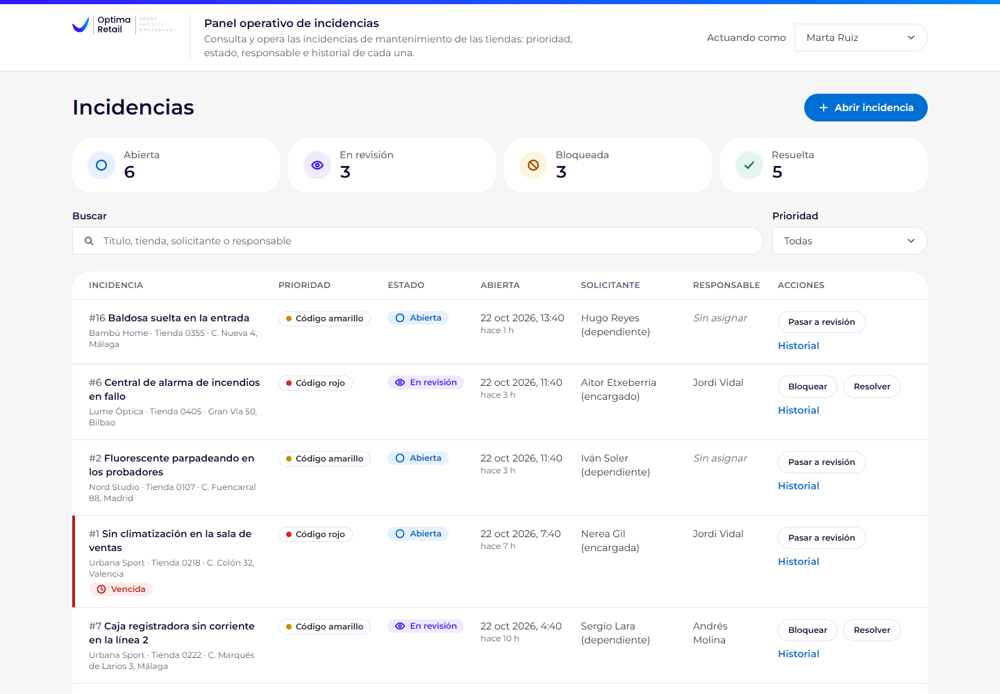
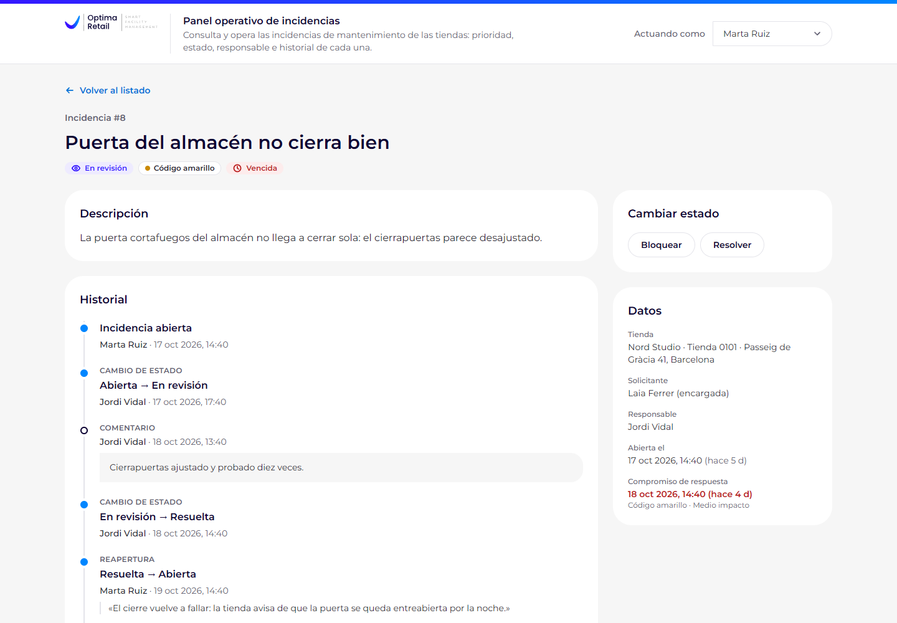
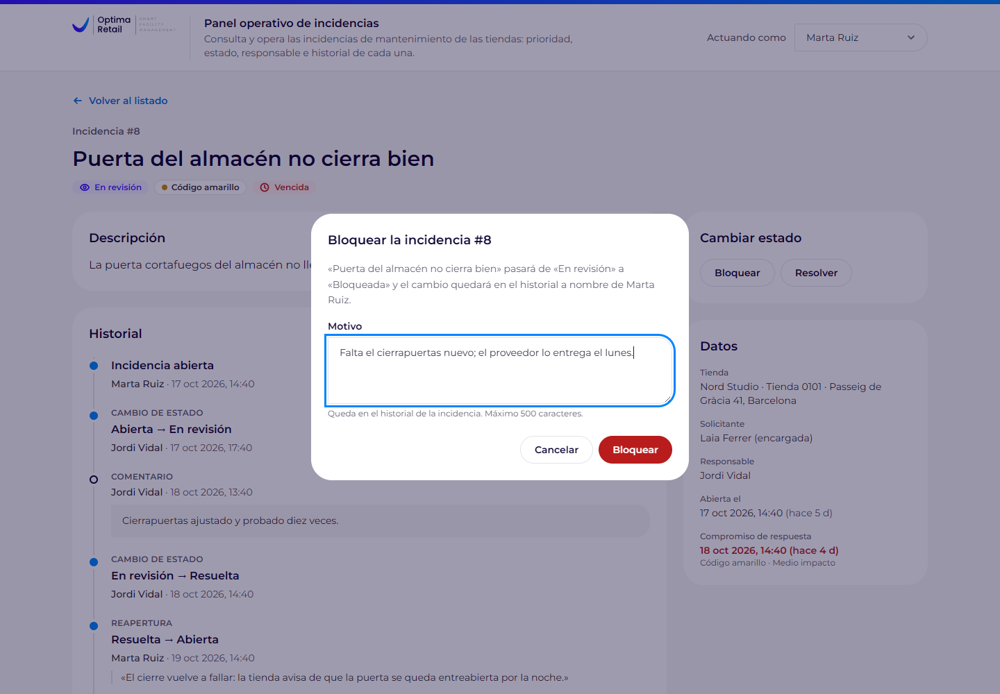
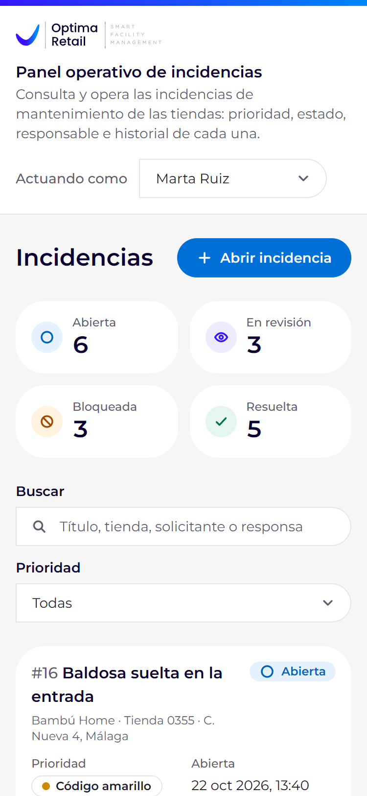

# Panel operativo de incidencias

[](https://github.com/danielbrosed/panel-operativo-incidencias/actions/workflows/ci.yml)

Prueba técnica mid/senior para Optima Retail: un panel para consultar y operar las incidencias de mantenimiento de una
red de tiendas (abrirlas, filtrarlas, cambiar su estado con trazabilidad y comentarlas) y un comando que diagnostica y
corrige con prudencia los datos inconsistentes. Laravel 13 sobre PHP 8.3+, MySQL 8.4, Inertia v3 + React 19 +
TypeScript y Tailwind 4.

La identidad visual sigue la de [optimaretail.eu](https://optimaretail.eu), incluida la prioridad por códigos verde,
amarillo y rojo de su formulario «Abrir incidencia». La tipografía es Montserrat, empaquetada en el proyecto (Gotham es
de pago). El logo (`public/brand/optima-retail.svg`) es una marca de Optima Retail SL y se usa solo para esta prueba.
Las tiendas, marcas y personas de los datos de ejemplo son ficticias.

<p>
  
  
</p>

<details>
<summary>Más capturas: confirmación con motivo y listado en el móvil</summary>
<p>
  
  
</p>
</details>

## Guía rápida para quien evalúa

| Requisito del enunciado | Dónde está |
|---|---|
| **Ej. 1** · Pantalla principal | `/incidents`: `resources/js/layouts/app-layout.tsx`, `resources/js/pages/incidents/index.tsx`, `resources/js/components/create-incident-form.tsx` y `status-actions.tsx`. Historial en `/incidents/{id}`: `resources/js/pages/incidents/show.tsx` |
| **Ej. 2** · Modelo de datos | `database/migrations/` (claves foráneas, índices y CHECK), `app/Enums/` (estados centralizados), `app/Models/` |
| **Ej. 3** · Acciones y validación | `app/Actions/Incidents/`, `app/Queries/IncidentListQuery.php`, `app/Http/Requests/`, `bootstrap/app.php` (errores de dominio en su campo), `lang/es/validation.php` |
| **Ej. 4** · Interacción | Filtro sin recarga: `resources/js/hooks/use-incident-filters.ts`. Contadores: `resources/js/components/status-counters.tsx`. Confirmación: `components/confirm-dialog.tsx`. Resaltado de vencidas y bloqueadas: `components/incident-list.tsx` |
| **Ej. 5** · Diagnóstico | `php artisan incidents:diagnose`: `app/Console/Commands/DiagnoseIncidents.php` y `app/Diagnostics/`. Datos rotos a propósito: `database/seeders/InconsistenciesSeeder.php`. Explicación: [más abajo](#diagnóstico-de-inconsistencias-ejercicio-5) |
| **Uso de IA** | [`ai-process/README.md`](ai-process/README.md), `CLAUDE.md`, `.claude/skills/` |
| **Entrega** | `.env.example` sin credenciales, `database/seeders/`, este README, `tests/`, `.github/workflows/ci.yml` |

## Requisitos

| | Versión | Notas |
|---|---|---|
| PHP | 8.3 o superior | CI con 8.3 y 8.4; en local, 8.4. Extensiones: `pdo_mysql`, `mbstring`, `intl`, `openssl`, `fileinfo`, `curl` y `xml`/`dom` |
| Composer | 2 | |
| Node.js y npm | 22.12 o superior | Desarrollado con Node 24 (`.nvmrc`) |
| MySQL | 8.0.16 o superior | Usa restricciones CHECK (MySQL las aplica desde la 8.0.16) y funciones ventana. Desarrollado y probado con 8.4 LTS. MariaDB no está probado |

No hace falta Docker.

## Instalación

```bash
git clone https://github.com/danielbrosed/panel-operativo-incidencias.git
cd panel-operativo-incidencias

composer install
cp .env.example .env          # en cmd.exe: copy .env.example .env
php artisan key:generate

# La base de la aplicación y la de los tests (añade -p si tu usuario tiene contraseña, o usa tu cliente de MySQL)
mysql -u root -e "CREATE DATABASE IF NOT EXISTS incidents CHARACTER SET utf8mb4 COLLATE utf8mb4_unicode_ci; CREATE DATABASE IF NOT EXISTS incidents_testing CHARACTER SET utf8mb4 COLLATE utf8mb4_unicode_ci;"

npm ci
npm run build
```

`.env.example` apunta a `root` sin contraseña en `127.0.0.1:3306`. Si tu MySQL es otro, cambia `DB_HOST`, `DB_PORT`,
`DB_USERNAME` y `DB_PASSWORD` en `.env`; los tests usan esos mismos datos contra `incidents_testing`.

Atajo: `composer setup` hace `composer install`, copia `.env` si no existe, genera la clave, `npm ci` y
`npm run build`. Las bases de datos se crean igualmente con el comando `mysql` de arriba.

## Base de datos y datos de ejemplo

```bash
php artisan migrate:fresh --seed
```

Borra y recrea las tablas de la base de `.env` (con `APP_ENV=production` Laravel lo impide) y carga:

- **16 incidencias coherentes** (`DemoIncidentsSeeder`, datos en `database/seeders/data/demo-incidents.php`), creadas
  con las mismas acciones que usa el panel y avanzando el reloj paso a paso. Las fechas son relativas al momento de
  sembrar, para que «vencida» tenga sentido el día que se ejecute. Incluye una reapertura legítima («Puerta del almacén
  no cierra bien») que el diagnóstico no debe señalar.
- **Las inconsistencias del ejercicio 5** (`InconsistenciesSeeder`): SQL directo que se salta la aplicación, como un
  arreglo a mano o una importación. Estropea tres de esas incidencias (#5, #9 y #11) y añade una cuarta importada
  (#17). Ver [diagnóstico](#diagnóstico-de-inconsistencias-ejercicio-5).

En total quedan 17 incidencias en los cuatro estados, con varias vencidas y bloqueadas. Los ids son siempre los
mismos tras `migrate:fresh --seed`.

Para repetir el ejercicio 5 desde cero, se vuelve a ejecutar `php artisan migrate:fresh --seed`.

## Arrancar

```bash
php artisan serve      # después de npm run build
```

Abre <http://127.0.0.1:8000> (la raíz redirige a `/incidents`). Para desarrollar, `composer run dev` levanta PHP
(puerto 8000) y Vite (puerto 5173) con recarga en caliente.

**Sin autenticación: no hay usuario de prueba; el selector «Actuando como» de la cabecera decide quién firma cada
acción.** Son cuatro operadores ficticios de `config/incidents.php`; la elección se guarda en la sesión.

Si algo falla:

- **Página en blanco o sin estilos** tras cortar `npm run dev` de golpe: borra `public/hot`. Vite lo deja al morir y la
  aplicación sigue pidiéndole los assets a un servidor que ya no existe.
- **Error de conexión a la base de datos**: revisa `DB_*` en `.env` y que la base `incidents` exista.
- **Los tests se niegan a arrancar** si el nombre de la base no contiene `_testing`. Es a propósito: borran el esquema.

## Recorrido de un minuto

1. Pulsa los **contadores por estado**: la lista se filtra sin recargar y la URL guarda el filtro. Cada contador
   respeta la prioridad y el texto buscados, así que su número es lo que verás al pulsarlo.
2. **Busca** «Valencia» (título, descripción, tienda y personas) y **filtra por prioridad**.
3. **Abre una incidencia** con el formulario vacío: cada error sale junto a su campo. Después créala bien: aparece la
   primera, abierta y con su vencimiento según la prioridad.
4. **Cambia el estado desde la lista**: cada fila ofrece solo las transiciones que permite el servidor. Resolver,
   bloquear y reabrir piden confirmación; bloquear y reabrir, además, un motivo.
5. Abre el **historial** de «Puerta del almacén no cierra bien»: cambios y comentarios en una sola línea de tiempo, con
   una reapertura y su motivo. Añade un comentario.
6. **Resaltado**: «Sin climatización en la sala de ventas» (código rojo, abierta hace 7 horas) sale vencida; «Goteras en
   el falso techo tras la lluvia», bloqueada.
7. Cambia **«Actuando como»** y haz otra acción: el historial la firma con el nuevo nombre. Abre la misma incidencia
   en dos pestañas, bloquéala en una e intenta resolverla en la otra: el diálogo avisa de que otra persona la cambió
   y recalcula los botones, en vez de pisar el cambio.

## Diagnóstico de inconsistencias (ejercicio 5)

```bash
php artisan incidents:diagnose                 # dry-run: enseña lo que haría y no escribe nada
php artisan incidents:diagnose -v              # además, el SQL exacto de cada comprobación
php artisan incidents:diagnose --fix           # aplica exactamente esa lista, tras pedir confirmación
php artisan incidents:diagnose --fix --force   # sin preguntar (CI)
```

- **Código de salida**: 1 si queda algo que `--fix` haría; 0 si no. Los casos ya marcados se listan como «en revisión
  manual», pero no cuentan.
- El dry-run y `--fix` comparten la misma lista de acciones. Cada corrección va en su transacción, con la incidencia
  bloqueada y el hallazgo comprobado otra vez dentro del bloqueo (entre el dry-run y el `--fix` pudo cambiar algo).
- Es idempotente: la segunda pasada no escribe nada. Sin `--force` y sin terminal interactiva, `--fix` no aplica nada.

### Regla única de corrección

> Solo se corrige automáticamente cuando (1) no cambia el estado de la incidencia, (2) no hay que inventar fecha, autor
> ni motivo, y (3) el hueco se explica con una única transición permitida por la máquina de estados que no exige
> motivo. Todo lo demás se marca para revisión manual.

El diagnóstico nunca cambia `incidents.status` (si la fila y su historial no coinciden, no sabe cuál dice la verdad) y
nunca borra ni atrasa un log. Un log reconstruido (`status_reconciled`) lleva la fecha real de la corrección, el actor
`sistema:diagnostico` y `metadata.inferred = true`; uno sobrante se anula con motivo y sigue a la vista, tachado.
Marcar es añadir un log `flagged_for_review`, que en el panel se ve como la insignia «Revisión manual».

### Los cuatro casos simulados

| Caso | Incidencia | Causa simulada | Qué queda en la base | Del enunciado | Resultado |
|---|---|---|---|---|---|
| A | #5 Fuga de agua en aseo de clientes | Soporte la dio por resuelta con un `UPDATE` a mano tras la llamada del técnico | `resolved`, con el último log de estado en `in_review` | Resuelta sin log de resolución | **Se concilia**: falta un único paso permitido y sin motivo (en revisión → resuelta) |
| B | #11 Persiana metálica de acceso no sube | Reabierta directamente en la base de datos | `open`, con el último log de estado en `resolved` | Estado distinto de su último log | **Se marca**: el paso que falta es una reapertura, que exige un motivo que no se puede inventar |
| C | #9 Puerta automática no abre | Doble clic en «Bloquear» en una versión sin bloqueo de fila | Dos logs `in_review → blocked` iguales, del mismo autor, con 1 s de diferencia | Log duplicado | **Se anula la copia** (#40), con un motivo que apunta al original (#18); no se borra |
| D | #17 Cuadro eléctrico salta de forma intermitente | Importación del sistema anterior (`importacion-legacy`) que perdió un paso | Solo `created` (null → open) y después `in_review → blocked`: falta abierta → en revisión | Log incoherente | **Se marca**: rellenar el hueco obligaría a inventar ese paso, con su fecha y su autor |

Cada caso salta solo en su comprobación (hay un test que lo garantiza) y la reapertura legítima de «Puerta del almacén
no cierra bien» no sale.

### Consultas y por qué detectan el problema

Son **logs de estado** `created`, `status_changed`, `reopened` y `status_reconciled` (`IncidentLogAction::statusTrail()`),
sin los anulados. El **último** es el primero por `created_at DESC, id DESC`.

1. **Resueltas sin log de resolución.** `ROW_NUMBER() OVER (PARTITION BY incident_id ORDER BY created_at DESC, id DESC)`
   da el último log de estado de cada incidencia. Si la incidencia está `resolved` y ese log no termina en `resolved`,
   nadie registró la resolución.
2. **Estado distinto del último log** (resto de estados): ese mismo log, comparado con `incidents.status`. Si no
   coinciden, la fila cambió por un camino que no dejó rastro.
3. **Logs duplicados o incoherentes.** `LAG()` compara cada log con el anterior de su incidencia. Duplicado: misma
   acción, valores y actor en 2 s o menos (`config/incidents.php`). Incoherente: su `old_value` no es el `new_value` del
   anterior, o `IncidentStatus` no permite esa transición.

En 1 y 2, si el salto entre el último log y el estado actual es una única transición permitida sin motivo, se concilia;
si no, se marca.

Las consultas interpolan los valores de los enums (acciones de log y pares de transiciones permitidas), así que nunca
se separan de la máquina de estados y no reciben ningún dato de usuario. Este es el SQL literal que ejecuta el comando
(`-v` lo imprime):

<details>
<summary>1 · Resueltas sin log de resolución</summary>

```sql
WITH last_trail AS (
    SELECT l.incident_id, l.id AS log_id, l.new_value,
        ROW_NUMBER() OVER (PARTITION BY l.incident_id ORDER BY l.created_at DESC, l.id DESC) AS rn
    FROM incident_logs l
    WHERE l.voided_at IS NULL
        AND l.action IN ('created', 'status_changed', 'reopened', 'status_reconciled')
)
SELECT i.id AS incident_id, i.title, i.status, t.log_id AS last_log_id, t.new_value AS logged_status
FROM incidents i
LEFT JOIN last_trail t ON t.incident_id = i.id AND t.rn = 1
WHERE i.status = 'resolved'
    AND (t.new_value IS NULL OR t.new_value <> 'resolved')
ORDER BY i.id
```

El `LEFT JOIN` conserva también las incidencias sin ningún log de estado (`new_value` llega como `NULL`).
</details>

<details>
<summary>2 · Estado distinto del último log</summary>

La misma consulta con otra condición: las resueltas son de la comprobación 1, así que una incidencia nunca sale en
las dos.

```sql
WHERE i.status <> 'resolved'
    AND (t.new_value IS NULL OR t.new_value <> i.status)
```
</details>

<details>
<summary>3 · Logs duplicados o incoherentes</summary>

```sql
WITH trail AS (
    SELECT l.id, l.incident_id, l.action, l.old_value, l.new_value, l.user_name, l.created_at,
        LAG(l.id) OVER w AS previous_id,
        LAG(l.action) OVER w AS previous_action,
        LAG(l.old_value) OVER w AS previous_old_value,
        LAG(l.new_value) OVER w AS previous_new_value,
        LAG(l.user_name) OVER w AS previous_user_name,
        TIMESTAMPDIFF(SECOND, LAG(l.created_at) OVER w, l.created_at) AS seconds_since_previous
    FROM incident_logs l
    WHERE l.voided_at IS NULL
        AND l.action IN ('created', 'status_changed', 'reopened', 'status_reconciled')
    WINDOW w AS (PARTITION BY l.incident_id ORDER BY l.created_at, l.id)
),
classified AS (
    SELECT t.*,
        CASE
            WHEN t.previous_id IS NOT NULL
                AND t.action = t.previous_action
                AND t.old_value <=> t.previous_old_value
                AND t.new_value <=> t.previous_new_value
                AND t.user_name = t.previous_user_name
                AND t.seconds_since_previous <= 2
                THEN 'duplicate'
            WHEN t.action <> 'created'
                AND (NOT (t.old_value <=> t.previous_new_value)
                    OR ((t.old_value, t.new_value) IN (('open', 'in_review'), ('in_review', 'blocked'), ('in_review', 'resolved'), ('blocked', 'in_review'), ('resolved', 'open'))) IS NOT TRUE)
                THEN 'broken_chain'
        END AS kind
    FROM trail t
)
SELECT c.incident_id, i.title, c.kind, c.id AS log_id, c.action, c.old_value, c.new_value, c.user_name,
    c.previous_id AS previous_log_id, c.previous_new_value, c.seconds_since_previous
FROM classified c
JOIN incidents i ON i.id = c.incident_id
WHERE c.kind IS NOT NULL
ORDER BY c.incident_id, c.created_at, c.id
```

Un duplicado también rompe la cadena, pero se clasifica como duplicado porque se sabe qué pasó.
</details>

### Salida real

El dry-run lista A, B, C y D y sale con 1; `--fix --force` concilia A, anula la copia de C y marca B y D (sale con 0);
la segunda pasada sale con 0 y muestra B y D ya en revisión manual; un segundo `--fix` no escribe nada. La CI comprueba
esos códigos (1 → 0 → 0) en cada push a `main`. Salida real tras `migrate:fresh --seed`:

```text
$ php artisan incidents:diagnose

1. Incidencias resueltas sin log de resolución (resolved_without_resolution_log)
+----------------------------+--------------------------------------------+--------------------------------------------+
| Incidencia                 | Detalle                                    | Acción prevista                            |
+----------------------------+--------------------------------------------+--------------------------------------------+
| #5 Fuga de agua en aseo de | Está «resuelta», pero su último log de     | Automática. Se añade un log                |
| clientes                   | estado (#6) la deja «en revisión».         | status_reconciled «en revisión» →          |
|                            |                                            | «resuelta» con la fecha de la corrección   |
|                            |                                            | (inferred): es el único paso posible y no  |
|                            |                                            | exige motivo.                              |
+----------------------------+--------------------------------------------+--------------------------------------------+

2. Incidencias cuyo estado no coincide con su último log (status_differs_from_last_log)
+----------------------------+--------------------------------------------+--------------------------------------------+
| Incidencia                 | Detalle                                    | Acción prevista                            |
+----------------------------+--------------------------------------------+--------------------------------------------+
| #11 Persiana metálica de   | Está «abierta», pero su último log de      | Revisión manual. Pasar de «resuelta» a     |
| acceso no sube             | estado (#24) la deja «resuelta».           | «abierta» exige un motivo que no consta en |
|                            |                                            | ningún sitio.                              |
+----------------------------+--------------------------------------------+--------------------------------------------+

3. Logs de estado duplicados o incoherentes (duplicate_or_incoherent_log)
+----------------------------+--------------------------------------------+--------------------------------------------+
| Incidencia                 | Detalle                                    | Acción prevista                            |
+----------------------------+--------------------------------------------+--------------------------------------------+
| #9 Puerta automática no    | El log #40 repite el #18 («en revisión» →  | Automática. Se anula el log #40 como       |
| abre                       | «bloqueada», Andrés Molina) 1 s después.   | duplicado del #18; no se borra.            |
| #17 Cuadro eléctrico salta | El log #42 («en revisión» → «bloqueada»)   | Revisión manual. Falta al menos un paso de |
| de forma intermitente      | no sigue al anterior, el #41, que la dejó  | la historia y no se sabe cuándo ni quién   |
|                            | «abierta».                                 | lo dio.                                    |
+----------------------------+--------------------------------------------+--------------------------------------------+

Resumen: 2 automáticas, 2 a revisión manual, 0 ya en revisión manual.
Regla: Solo se corrige automáticamente cuando (1) la corrección no cambia el estado de la incidencia, (2) no
hay que inventar fecha, autor ni motivo y (3) el hueco se explica con una única transición permitida que no
exige motivo. Todo lo demás se marca para revisión manual. Ningún log se borra ni se atrasa.

Simulación: no se ha modificado nada. Ejecuta con --fix para aplicar las correcciones.
```

```text
$ php artisan incidents:diagnose --fix --force
(… el mismo informe …)
#5 Fuga de agua en aseo de clientes (resolved_without_resolution_log): aplicada.
#11 Persiana metálica de acceso no sube (status_differs_from_last_log): aplicada.
#9 Puerta automática no abre (duplicate_or_incoherent_log): aplicada.
#17 Cuadro eléctrico salta de forma intermitente (duplicate_or_incoherent_log): aplicada.

Resultado: 4 aplicadas, 0 omitidas.

$ php artisan incidents:diagnose
1. Incidencias resueltas sin log de resolución (resolved_without_resolution_log)
Sin hallazgos.
(… #11 y #17: «Ya marcada para revisión manual (22/10/2026 12:47 UTC)» …)
Resumen: 0 automáticas, 0 a revisión manual, 2 ya en revisión manual.
Nada que corregir: lo que queda ya está marcado para revisión manual.
```

### Qué hace una persona con un caso marcado

1. Lo localiza en la salida del comando o por la insignia «Revisión manual»; el historial de la incidencia muestra la
   entrada del marcado con la explicación.
2. Averigua qué pasó fuera de la base de datos: el parte del técnico, la tienda, quién lanzó el SQL o la importación.
   Sin eso, cualquier corrección sería inventada.
3. Deja la conclusión como comentario en la ficha (con autor y fecha reales) y, si el estado correcto es otro, lleva la
   incidencia hasta él con las transiciones normales del panel, que quedan registradas.
4. Retira la marca anulando su log con el motivo (el id está en el historial). En esta versión no hay botón para
   hacerlo; es el siguiente paso natural de la ficha:

   ```bash
   php artisan tinker --execute="App\Models\IncidentLog::findOrFail(44)->void('Revisada por Marta Ruiz: se confirmó la reapertura con la tienda.')"
   ```

### Cómo se evita que vuelva a pasar

- El estado solo cambia con `ChangeIncidentStatus` (`status` no está en `$fillable`), y estado y log se guardan en la
  misma transacción: desde el panel no pueden salir A ni B.
- `lockForUpdate()` y estado esperado: la segunda petición de un doble clic espera al bloqueo, ve la incidencia ya
  bloqueada y responde «La incidencia ya está «bloqueada».» en vez de escribir otro log (C). Si fue otra persona quien
  la cambió, el aviso es de conflicto.
- CHECK en `status`, `priority` y `incident_logs.action`, y log solo de inserción: el modelo impide editarlo o borrarlo;
  solo deja anularlo una vez, con motivo.
- Un `UPDATE` a mano o una importación que se salte las acciones (A, B y D) no los puede impedir la aplicación: para eso
  están los permisos de producción y este diagnóstico.

### Límites

- No sabe si la verdad está en la fila o en el historial: por eso nunca cambia estados.
- Si alguien cambia la fila a mano **y** escribe un log que cuadra, no hay nada que detectar.
- El duplicado depende de la ventana de 2 s y del mismo actor. Dos clics más separados no cuentan como duplicado, pero
  la máquina de estados no permite repetir una transición seguida, así que saldrían como incoherentes y se marcarían.
- Solo mira el rastro de estado (no comentarios ni `due_at`) y recorre todo `incident_logs` en cada pasada; con mucho
  volumen se haría por tramos de `incident_id`.
- Caso raro que no está en los datos sembrados: si una incidencia tiene a la vez el estado cambiado a mano y un log
  duplicado como último log, la primera pasada la marca usando el duplicado como evidencia y anula el duplicado; la
  segunda la vuelve a marcar con la nueva evidencia. A partir de ahí es estable.

### En producción

- **Copia antes de `--fix`**, guardada con la salida del dry-run. `--single-transaction` da una foto coherente de
  InnoDB sin bloquear escrituras:

  ```bash
  mysqldump --single-transaction --no-tablespaces incidents > incidents-antes-del-fix.sql
  ```

- **El usuario de la aplicación, sin `DELETE` ni `UPDATE` general sobre `incident_logs`**, para que el «solo
  inserción» no dependa solo del modelo (las migraciones, con otro usuario):

  ```sql
  GRANT SELECT, INSERT, UPDATE ON incidents.incidents TO 'panel'@'localhost';
  GRANT SELECT, INSERT ON incidents.incident_comments TO 'panel'@'localhost';
  GRANT SELECT, INSERT, UPDATE (voided_at, voided_reason) ON incidents.incident_logs TO 'panel'@'localhost';
  ```

## Decisiones técnicas

- **Inertia + React**: un solo proyecto con las rutas, la validación y la sesión de Laravel, y componentes tipados sin
  una API que mantener. Sin SSR (es un panel interno) y sin Ziggy ni Wayfinder: el servidor manda las URLs en las props
  (son seis rutas), así que compilar el frontend no necesita PHP.
- **Enums como única fuente de verdad** (`app/Enums/`): `IncidentStatus` define estados, etiquetas, transiciones, cuándo
  piden motivo y confirmación y qué acción de log toca. Las acciones lo aplican, los API Resources mandan a cada
  incidencia sus transiciones permitidas y el diagnóstico lo usa para juzgar los huecos. Las migraciones escriben los
  valores de las CHECK a propósito: son una foto del esquema.
- **Máquina de estados**:

  | desde \ a | abierta | en revisión | bloqueada | resuelta |
  |---|---|---|---|---|
  | abierta | – | sí | no | no |
  | en revisión | no | – | sí: **motivo obligatorio** y confirmación | sí: confirmación, nota opcional |
  | bloqueada | no | sí (desbloquear) | – | no |
  | resuelta | sí: **reapertura**, acción `reopened`, motivo obligatorio y confirmación | no | no | – |

  Bloquear pide motivo porque es lo que necesita quien desbloquee; reabrir, para que la reapertura sea explícita. Una
  bloqueada vuelve a revisión antes de resolverse, para que toda resolución siga a trabajo activo.
- **Acciones con transacción, bloqueo y estado esperado** (`app/Actions/Incidents/`). `ChangeIncidentStatus` bloquea la
  fila (`SELECT … FOR UPDATE`), trabaja con la copia recién leída, comprueba que el estado sigue siendo el que vio la
  persona (protege de una pantalla desactualizada), la transición y el motivo, y guarda estado y log juntos.
  `CreateIncident` escribe la incidencia y su log `created` en la misma transacción. `AddIncidentComment` es un único
  insert que no toca la incidencia: no necesita transacción.
- **Errores en su campo**: los errores de dominio se convierten en errores de validación sobre `status` o `reason` y
  salen en el mismo formulario. Un cliente JSON recibe 422, o 409 si el estado estaba desactualizado; a Inertia nunca
  se le manda un 409, que reserva para sus redirecciones. Una sesión caducada (419) o el exceso de peticiones (429)
  vuelven atrás con un aviso.
- **Historial solo de inserción** (`app/Models/IncidentLog.php`): un log se anula una vez, con motivo, pero no se edita
  ni se borra; la clave foránea `RESTRICT` impide borrar una incidencia con historial. Sin columnas `resolved_at` ni
  «marcada»: serían otra fuente de verdad que conciliar; la insignia «Revisión manual» se calcula desde los logs.
- **Actor sin autenticación**: `App\Support\CurrentActor` lee de la sesión el operador elegido, de la lista de
  `config/incidents.php`, y su nombre se guarda como foto en cada log y comentario. Es el único sitio que cambiaría por
  `auth()->user()`.
- **Índices**: `incidents (status, created_at)`, `(priority, created_at)` y `(created_at)`, porque la lista filtra por
  estado o prioridad y siempre ordena por fecha (InnoDB añade la clave primaria a cada índice secundario, así que el
  desempate por `id` también sale del índice). `incident_logs (incident_id, created_at, id)`, para el historial en orden
  y las funciones ventana del diagnóstico. `incident_comments (incident_id, created_at)`.
- **Búsqueda con `LIKE` escapado** (`App\Support\Like`): `%`, `_` y `\` se buscan literalmente. Un `LIKE '%…%'` no usa
  índices, pero basta para un panel operativo; a escala, índice `FULLTEXT` o un motor de búsqueda.
- **Vencimiento (`due_at`) fijado al crear**: es el compromiso de ese momento y no se mueve si cambia la política de
  SLA. Código rojo, 4 h, la promesa pública de Optima Retail para urgencias; amarillo 24 h y verde 72 h son supuestos
  de esta prueba.
- **Los comentarios no generan log**: el comentario ya es su propia traza y saldría dos veces en el historial.
- **CHECK** en `status`, `priority` e `incident_logs.action`: defensa ante escrituras que se saltan la aplicación,
  justo las del ejercicio 5. `created_at` y `updated_at` con valor por defecto en la base, por el mismo motivo.
- **Seguridad**: CSRF, `$fillable` explícito, `Model::shouldBeStrict()` fuera de producción (un N+1 lanza excepción),
  60 escrituras por minuto e IP, nada de `dangerouslySetInnerHTML`, y entradas manipuladas (arrays, UTF-8 inválido)
  rechazadas como error de validación en vez de un 500. Cabeceras de seguridad y CSP con nonce
  (`app/Http/Middleware/SecurityHeaders.php`): en local va como `Report-Only`, para que nadie vea una página en blanco
  por una violación; en tests y producción se aplica (`CSP_MODE=enforce`). `.npmrc` con `ignore-scripts=true`.
- **Tests contra MySQL, no SQLite**: el bloqueo de fila, las CHECK, el JSON y las funciones ventana son parte de lo
  probado, y SQLite no los reproduce (no tiene `FOR UPDATE`).
- **Plataforma de PHP fijada en 8.3** (`config.platform.php`): el `composer.lock` se resuelve para 8.3 aunque se genere
  con 8.4. Sin eso, Composer en 8.4 traería Symfony 8, que ya exige PHP 8.4.

## Frontend: dónde vive el estado

- **Dónde vive el estado.** Los filtros viven en la URL (`?status=…&priority=…&q=…`) y los datos los manda siempre el
  servidor como props de Inertia, tipadas en `resources/js/types/incident.ts` (espejo de los API Resources): el cliente
  no guarda ninguna copia de las incidencias. Cada incidencia trae sus transiciones permitidas, así que el frontend no
  tiene copia de la máquina de estados. Lo único local:
  - el texto de la búsqueda mientras se escribe y los filtros de la visita en curso (`hooks/use-incident-filters.ts`);
  - los formularios (`useForm` en `create-incident-form.tsx`, `status-actions.tsx` y `comment-form.tsx`);
  - qué diálogo de confirmación está abierto (`status-actions.tsx` con `confirm-dialog.tsx`);
  - si el formulario de alta está desplegado (`pages/incidents/index.tsx`).
- **Dónde se dispara la acción.** Las visitas de filtrado salen solo de `use-incident-filters.ts` (contadores, prioridad,
  búsqueda con 300 ms de espera e Intro inmediato, «Quitar filtros»), como recarga parcial
  (`only: ['incidents', 'counts', 'filters']`, `preserveState`, `replace`): el servidor calcula solo esas tres props (lo
  comprueba un test). Crear, cambiar de estado, comentar y «Actuando como» salen de su propio componente
  (`create-incident-form.tsx`, `status-actions.tsx`, `comment-form.tsx`, `actor-switcher.tsx`), cada formulario con su
  `errorBag` para que los errores vuelvan al formulario que los provocó.
- **Cómo se refresca.** El servidor contesta con una redirección, Inertia vuelve a pedir la página y con las props
  nuevas se repintan la fila, las insignias, los contadores y el historial. El aviso (`flash.toast`) lo muestra
  `flash-toaster.tsx` escuchando el evento `flash` del router. Tras un cambio de estado el foco pasa al primer botón
  nuevo de esa incidencia.
- La lista es una tabla desde 1024 px y tarjetas por debajo: siete columnas más las acciones no caben en menos.

## Tests y calidad

```bash
php artisan test     # contra la base incidents_testing
composer check       # Pint, Larastan (nivel 8), tsc, ESLint y los tests
```

Los tests usan `incidents_testing` (lo fija `phpunit.xml`) con el host y el usuario de `.env`, y no necesitan
`npm run build`. Cubren la matriz completa de transiciones, filtros y escapado de `LIKE`, contadores, recarga parcial,
validación (también entradas manipuladas: arrays donde va texto, UTF-8 inválido), estado desactualizado y doble envío,
rollback si falla el log, el `FOR UPDATE`, la inmutabilidad del log, las CHECK y claves foráneas, las cabeceras de
seguridad y el diagnóstico (sin falsos positivos con datos limpios, dry-run que no toca nada, cada caso sembrado,
idempotencia y códigos de salida). En total, 77 tests y 408 aserciones.

Integración continua (`.github/workflows/ci.yml`, acciones fijadas por commit):

| Trabajo | Qué hace |
|---|---|
| Backend · PHP 8.3 y 8.4 con MySQL 8.4 | `composer validate`, instalación, build, Pint, Larastan, tsc, ESLint y Prettier, tests y una prueba de humo que sigue este README: `migrate:fresh --seed` y el diagnóstico, con las salidas 1 → 0 → 0 |
| Frontend · Linux, Windows y macOS | `npm ci`, tsc y build: detecta importaciones que solo funcionan porque Windows no distingue mayúsculas |
| Auditoría de dependencias | `composer audit` y `npm audit --audit-level=high` |

## Lo que dejé fuera a propósito

- **Autenticación, roles y permisos**: no se piden. `CurrentActor` es el único punto que cambiaría.
- **Notificaciones, Docker, despliegue público e integraciones externas**, como recomienda la sección 11 del enunciado.
- **Funciones de IA dentro del panel**: quedan como siguiente paso.
- **Triggers en la base de datos**: con el binlog activo, lo habitual en MySQL 8.4, crearlos puede exigir privilegios
  de administrador que quien revise no tiene por qué tener. La protección del historial está en el modelo y, en
  producción, en los permisos por columna.

## Uso de IA

Herramientas, prompts, qué generó la IA, qué se decidió a mano y qué errores suyos se detectaron:
[`ai-process/README.md`](ai-process/README.md). Las reglas con las que se dirigió están en el repositorio: `CLAUDE.md`
y las tres skills de `.claude/skills/` (`incident-domain`, `data-fix-protocol` y `review-checklist`).

## Siguientes pasos

- Usuarios reales con autenticación, y `assigned_to` como clave foránea a `users`.
- Búsqueda con índice `FULLTEXT` cuando el volumen lo pida.
- Política de SLA en una tabla (por cliente, marca o tipo de tienda) en lugar de en el enum.
- Avisos cuando una incidencia está a punto de vencer o vence.
- IA para Optima Retail: sugerir prioridad y categoría a partir de la descripción al abrir una incidencia, y resumir el
  historial de las largas. Detrás de un *feature flag* y siempre como sugerencia que una persona confirma.
